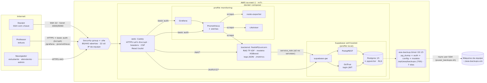

<!-- MODELO. Não edite relatorio_monitoramento.md à mão: ele é gerado por
     python3 "src/Entrega 2/infra/scripts/gerar_relatorio.py" "<esta pasta>"
     e todos os números entre chaves duplas são LIDOS dos arquivos em evidencias/. -->
# ASA Turbo · Relatório de infraestrutura, monitoramento e operação em nuvem

**Disciplina:** Sistemas Operacionais e Computação em Nuvem · **Entrega 2** · FECAP, 2026.2
**Branch:** `entrega2/nuvem` · **Endereço:** <https://54-207-148-68.sslip.io> (acesso controlado, seção 9)
*Rascunho para revisão da equipe. Os números foram gerados a partir dos arquivos de resultado (`evidencias/`).*

## 1. Objetivo e arquitetura

Publicar a solução integrada do ASA Turbo (API FastAPI, banco Postgres com pgvector, login, agente de chat RAG, modelo de risco e front PWA) numa VM Linux na nuvem, com:
- empacotamento reproduzível;
- observabilidade de CPU, memória, latência e erros;
- segurança, acesso controlado e segredos fora do Git;
- teste de carga com análise de gargalo;
- backup e restauração testados de verdade.

*(Fonte: `diagramas/arquitetura.mmd`; PNG gerado com mermaid-cli.)*

Fluxo:
1. O navegador fala só com o **Caddy** (HTTPS na porta 443). O Caddy entrega o front, repassa `/api/*` ao **backend** e `/auth/v1/*` ao **GoTrue** (login).
2. O backend consulta o **Postgres** pelo **PostgREST**, com a chave `service_role`, que só existe no servidor. O RBAC é aplicado no backend e a RLS no banco.
3. O **Prometheus** raspa o backend, o **node-exporter** (host) e o **cAdvisor** (containers). O **Grafana** mostra os painéis. Os dois ficam atrás de basic auth.

## 2. Infraestrutura e justificativa das escolhas

| Item | Escolha | Por quê |
|---|---|---|
| Nuvem/região | AWS `sa-east-1` (São Paulo) | menor latência para os usuários (alunos e ASA da FECAP) e dados no Brasil (LGPD) |
| VM | `m7i-flex.large`: 2 vCPU, 8 GB, gp3 de 30 GB, Ubuntu 24.04 LTS | o compose completo (10 containers) usa cerca de 2 GB e os limites somam cerca de 4 GB; sobra memória para o build. LTS com patches até 2029 |
| Endereço | IP elástico 54.207.148.68 + `54-207-148-68.sslip.io` | sem domínio próprio, o sslip.io resolve o nome para o IP e o Let's Encrypt consegue validar (desafio HTTP-01). O IP elástico sobrevive à troca de instância (runbook) |
| Empacotamento | Docker Compose, imagens multi-stage, não-root, HEALTHCHECK | o mesmo `docker-compose.yml` roda na máquina da equipe e na VM. Perfis: padrão (app + proxy), `local` (banco/login) e `monitoring` |
| Proxy | Caddy 2.8 | HTTPS automático com renovação, HTTP/2 e 3, headers e basic auth com bcrypt, numa configuração de 100 linhas |
| Banco | Postgres 15 + pgvector (imagem `supabase/postgres`), PostgREST e GoTrue **na própria VM** | não temos as chaves do Supabase gerenciado. A mesma stack do Supabase, self-hosted, roda sem nenhuma mudança no backend (que fala a API do Supabase) e permite testar backup e restauração de verdade. O Supabase gerenciado continua sendo uma opção trocando só o `.env` (`SUPABASE_URL`, `DATABASE_URL`) |
| Serviço | systemd `asa.service` (compose no boot) e `asa-backup.timer` | sobe sozinho depois de reboot (testado, seção 7.3) |
| Embeddings | fallback TF-IDF (lexical, em memória) | a VM não tem token da Cloudflare nem do Hugging Face. O teste de carga não toca serviços de terceiros |

Limites por container (`docker-compose.yml`, `deploy.resources.limits`):

| Serviço | CPU | Memória |
|---|---|---|
| backend | 1,5 | 1 GB |
| db | 1,0 | 1 GB |
| prometheus | 0,5 | 512 MB |
| grafana | 0,5 | 384 MB |
| web (Caddy), gotrue, postgrest, cadvisor, db-init | 0,5 | 256 MB |
| supabase-gw, node-exporter | 0,25 | 128 MB |

Memória total da VM: 7.6Gi.

## 3. Configuração do Linux e permissões

Tudo é feito por **`infra/deploy/provision.sh`**, idempotente: a 2ª execução não reescreve nenhum arquivo.

| Passo | O que faz |
|---|---|
| Pacotes | `apt upgrade` + `unattended-upgrades` (patches de segurança diários), fuso America/Sao_Paulo |
| Docker | repositório oficial, plugin compose, `daemon.json` com rotação de log (10 MB × 5) e `live-restore` |
| Firewall | `ufw`: nega entrada por padrão; 22, 80 e 443 abertas; 9100 (node-exporter) só para as redes do Docker. Na AWS, o security group libera a 22 só para o IP da equipe |
| SSH | drop-in `00-asa-hardening.conf`: `PermitRootLogin no`, `PasswordAuthentication no`, `MaxAuthTries 3`. É validado com `sshd -t` antes do reload, para não trancar o acesso |
| fail2ban | jail `sshd`: 5 falhas em 10 min = 1 h de bloqueio |
| Usuário de serviço | `asa`: sem senha (`passwd -l`), shell `nologin`, fora do sudoers, no grupo `docker` |
| Diretórios | `/opt/asa` 750, `/opt/asa/backups` 700, `.env` 600, todos do `asa` |
| systemd | `asa.service` (habilitado) e `asa-backup.timer` (todo dia às 03:15, `Persistent=true`) |
| logrotate | `/etc/logrotate.d/asa` para os logs do host. Os dos containers giram no driver `json-file`, e o log JSON do backend também gira (`RotatingFileHandler`) |

Evidência coletada via SSH (`infra/scripts/evidencias.sh` → `evidencias/vm_20261109_183753.txt`):
- `uname -a`: `Linux ip-172-31-17-67 7.0.0-1014-aws #14~24.04.1-Ubuntu SMP PREEMPT Fri Sep 18 21:24:59 UTC 2026 x86_64 x86_64 x86_64 GNU/Linux`
- distribuição: `Ubuntu 24.04.5 LTS`
- `id asa`: `uid=999(asa) gid=987(asa) groups=987(asa),988(docker)`
- `.env`: `modo=600 dono=asa grupo=asa`
- certificado emitido por: `C = US, O = Let's Encrypt, CN = YE2`
- fail2ban (sshd): 0 falhas registradas, 0 IPs banidos no momento. Os números estão zerados porque o security group da AWS só deixa a porta 22 chegar do IP da equipe. O fail2ban é a segunda camada, caso essa regra seja aberta

O mesmo arquivo traz ainda `ufw status verbose`, `ss -tlnp`, `docker ps`, `docker stats`, os limites de cada container, `systemctl status`, `journalctl`, `df -h`, `free -h`, `top` e `ps`.

**Ponto de atenção honesto:** estar no grupo `docker` equivale a ter root no host. Escolhemos isso para o compose rodar sem `sudo`. A mitigação é que o `asa` não tem senha nem shell de login, e só a equipe (por chave SSH) chega até ele.

## 4. Segurança, acesso e política de segredos

O detalhamento está em **`politica_segredos.md`** (inventário, regras, rotação sem derrubar o serviço e matriz de acesso). Resumo:
- **Segredos:** nunca no Git. O gitleaks no histórico inteiro deu 134 commits verificados, resultado `no leaks found` (`evidencias/gitleaks.txt`). Os segredos de produção foram gerados na própria VM e o `.env` é 600 do `asa`. A `service_role` fica só no backend; o front recebe só a chave `anon`.
- **Transporte:** HTTPS com Let's Encrypt, redirecionamento 308 de HTTP e HSTS de 1 ano.
- **Headers:** CSP estrita no app, `X-Frame-Options DENY`, `nosniff`, `Referrer-Policy`, `Permissions-Policy`, COOP. O header `Server` é removido.
- **CORS:** restrito à origem `https://54-207-148-68.sslip.io`.
- **Rate limiting:**
  - chat com 20 mensagens/min por usuário (a carga gerou 21 e 42 respostas 429: o limite funcionando);
  - login com o limite do GoTrue;
  - corpo da API limitado a 1 MB no Caddy.
- **RBAC do app:** estudante, atendente e administrador. Funciona por JWT do GoTrue, `exigir_papeis` no backend e RLS no Postgres. O smoke confere que o estudante recebe 403 em `/casos`.
- **Monitoramento fechado:** `/grafana` e `/prometheus` exigem basic auth (bcrypt custo 14) e, no Grafana, login com papel **Viewer** para o professor. O `/metrics` do backend responde 404 pelo proxy. Prometheus e Grafana não publicam porta para fora; a equipe também pode usar o túnel SSH.

## 5. Observabilidade: o que se mede e como

| Camada | Fonte | Métricas |
|---|---|---|
| Aplicação | `/metrics` do backend (`prometheus_client`) | `http_requests_total{rota,metodo,status}`, `http_request_duration_seconds` (histograma por rota), `http_erros_total`, `chat_respostas_total{abstencao}`, `chat_abstencoes_total{motivo}`, `rag_recuperacoes_total{metodo}`, `rag_fallback_total`, `embedding_falhas_total`, `embedding_cache_acertos_total`, `risco_inferencias_total`, `validacoes_total` |
| Host | node-exporter (rede e PID do host) | CPU (uso total, iowait), memória, disco `/`, rede da `enp39s0`, load average |
| Containers | cAdvisor (cgroups v2) + `docker_sd` do Prometheus para os nomes | CPU e memória por serviço do compose |
| Logs | backend em JSON (stdout + arquivo rotacionado) | `ts`, `nivel`, `request_id` (também no header `X-Request-ID`), `usuario_id`, `papel`, `rota`, `status`, `latencia_ms`. O Caddy grava o log de acesso em JSON |

**Painel** "ASA Turbo · Operação" (`infra/monitoring/grafana/dashboards/asa-turbo.json`, provisionado por arquivo junto com o datasource):
- requisições/s (geral e por rota);
- latência p50, p95 e p99, e p95 por rota;
- taxa de 5xx e erros por status;
- abstenção (taxa e motivos);
- RAG por método, fallback de embeddings e cache;
- CPU e memória por container;
- CPU, memória, disco, rede e load do host;
- lista de alertas.

Prints em `evidencias/prints/`. Os `grafana_antes_*` e `grafana_depois_*` foram capturados no platô de 100 VUs.

**Alertas** (`infra/monitoring/alertas.yml`, validados com `promtool`):

| Alerta | Regra |
|---|---|
| TaxaDeErroAlta | 5xx > 5% por 2 min |
| LatenciaP95Alta | p95 > 2 s por 5 min |
| DiscoQuaseCheio | `/` > 85% por 1 min |
| MemoriaDoHostAlta | > 90% por 5 min |
| BackendFora | `up{job="backend"} == 0` por 1 min |
| ContainerFora | serviço do compose que sumiu |

Não há Alertmanager: o alerta aparece como *firing* no Prometheus e no Grafana, sem envio por e-mail.

## 6. Teste de carga, gargalo e ajustes

**Ferramenta:** k6 0.54, rodando **na máquina da equipe** contra a URL pública. Isso inclui TLS, Caddy e a rede real até São Paulo.

**Cenários** (`infra/loadtest/rampa.js`):
- login no GoTrue (1 por usuário virtual);
- `/api/health` a 5 req/s constantes;
- cerca de 75% dos usuários virtuais como estudantes no `/api/chat` (10 perguntas que se repetem; pausa de 3 a 6 s);
- cerca de 25% como atendentes em `/api/casos` + `/api/casos/{id}` (pausa de 2 a 5 s).

**Rampa:** 10 → 50 → 100 usuários virtuais (30 s + 90 s a 10; 60 s + 120 s a 50; 60 s + 180 s a 100; 30 s de descida), cerca de 9,5 min.

**Usuários:** 100 estudantes e 10 atendentes fictícios (`criar_usuarios_rampa.sh`).

**Importante:** o `/chat` rodou no **fallback TF-IDF** (em memória). A VM não tem token de embeddings, então a carga não chamou o Hugging Face nem a Cloudflare. A latência medida do chat **não** inclui a chamada externa de embeddings, que em produção custaria de 200 a 1.000 ms por pergunta não repetida (mitigada pelo cache de embeddings de perguntas repetidas, `EMBEDDING_CACHE_MAX`).

Como a rampa tem pausas, ela mede a experiência de usuários reais, mas não acha o limite. Por isso rodamos também um **teste de estresse** em modelo aberto (`infra/loadtest/estresse.js`):
- `/api/casos` com chegada de 10 → 40 → 80 → 120 req/s em degraus de 45 s;
- mais `/api/chat` a 15 req/s.

As séries de CPU e latência de cada rodada foram exportadas do Prometheus (`evidencias/carga/series_*.csv`).

### 6.1 Resultado da rampa (antes × depois)

| Métrica | antes | depois | Variação |
|---|---:|---:|---:|
| Requisições (total) | 13.095 | 13.110 | +0% |
| Throughput médio (req/s) | 22,84 | 22,88 | +0% |
| Taxa de falha HTTP | 0,16% | 0,34% | |
| Taxa de 5xx | 0,00% | 0,00% | |
| Respostas 429 (rate limit do chat) | 21 | 42 | |
| /health p50 (ms) | 8,6 | 8,6 | +1% |
| /health p95 (ms) | 13,7 | 14,0 | +2% |
| /health p99 (ms) | 20,4 | 23,3 | +14% |
| login p50 (ms) | 14,6 | 14,8 | +1% |
| login p95 (ms) | 23,1 | 22,9 | -1% |
| login p99 (ms) | 82,6 | 24,5 | -70% |
| /chat p50 (ms) | 17,6 | 17,2 | -2% |
| /chat p95 (ms) | 32,3 | 31,6 | -2% |
| /chat p99 (ms) | 51,3 | 60,5 | +18% |
| /casos p50 (ms) | 43,3 | 25,2 | -42% |
| /casos p95 (ms) | 73,5 | 42,5 | -42% |
| /casos p99 (ms) | 102,7 | 79,3 | -23% |
| /casos/{id} p50 (ms) | 19,6 | 19,4 | -1% |
| /casos/{id} p95 (ms) | 36,8 | 34,7 | -6% |
| /casos/{id} p99 (ms) | 54,4 | 57,4 | +6% |
| Abstenção do chat | 10,28% | 9,74% | |

Com 100 usuários virtuais a VM ficou folgada:
- pico de CPU do host: 36,2% antes e 34,3% depois;
- backend: até 0,25 núcleo;
- Postgres: 0,19 → 0,12 núcleo;
- nenhum 5xx.

A vazão é a mesma nas duas rodadas porque é ditada pelas pausas dos usuários, não pelo servidor. A diferença aparece na rota mais cara: **`/casos` p50 43,3 → 25,2 ms e p95 73,5 → 42,5 ms (-42%)**. As falhas (0,16% e 0,34%) são todas 429 do rate limit do chat, que é proposital.

### 6.2 Estresse: onde está o gargalo

| Rodada | Ajuste | Req/s (k6) | Pico de req/s (Prometheus) | Falhas | /casos atendidos | /casos p50 (ms) | /casos p95 (ms) | Último degrau com p95 < 500 ms | CPU backend (cores, máx) | CPU db (máx) | CPU host (máx) |
|---|---|---:|---:|---:|---:|---:|---:|---|---:|---:|---:|
| estresse_antes | nenhum (1 worker) | 54,28 | 60,0 | 0,01% | 4.404 | 8.989,8 | 11.646,0 | 44,8 req/s | 0,73 | 0,71 | 99,7% |
| estresse_rls | + policies RLS com InitPlan (005) | 53,39 | 59,3 | 0,04% | 4.306 | 9.216,0 | 11.952,6 | 35,5 req/s | 0,71 | 0,71 | 99,7% |
| estresse_cache | + cache de 10 s da contagem da fila | 77,49 | 91,6 | 0,00% | 6.799 | 5.115,6 | 6.269,7 | 83,9 req/s | 0,80 | 0,55 | 98,5% |
| estresse_workers2 | + UVICORN_WORKERS=2 (revertido) | 70,25 | 82,4 | 0,13% | 6.082 | 5.488,1 | 7.543,5 | 66,6 req/s | 0,88 | 0,52 | 100,0% |

*"Último degrau com p95 < 500 ms" é a maior vazão (janela de 30 s no Prometheus) em que a API ainda respondia com p95 abaixo de 500 ms: o joelho da curva. Acima dele, a fila cresce e a latência vai a segundos. Os quantis acima de 8 s ficam presos ao último bucket do histograma (15 s).*

**Diagnóstico, na ordem em que foi feito** (Grafana + `docker stats` + `pg_stat_statements`):

1. **Na saturação, a CPU do host bate 100%** (99,7% na rodada inicial), dividida entre backend (0,73 núcleo), Postgres (0,71), PostgREST, gateway e Caddy. Não há folga de memória a explorar: os containers usam menos de 400 MB cada.
2. O `pg_stat_statements` apontou a **view da fila (`vw_fila_risco_busca`)** como o maior consumidor do Postgres. Cada `GET /casos` a consulta **4 vezes**: a página e mais 3 contagens por categoria (verde, amarelo e vermelho), e a view recalcula o último score de cada aluno a cada consulta.
3. **Hipótese 1 (errada, mas útil):** policies RLS reavaliando `eh_equipe_asa()`/`uid()` a cada linha. Com o papel de um atendente, a contagem levava 350 ms; sem RLS, 2,7 ms. A migration **`infra/sql/005_rls_initplan.sql`** envolve as funções em `(select ...)` (InitPlan), o que derrubou a consulta para 6 ms com o RBAC preservado. **Mas a vazão não mudou** (54,3 → 53,4 req/s), porque o backend acessa o PostgREST com a `service_role`, que **ignora a RLS**. A correção ficou: ela beneficia todo acesso feito com o JWT do usuário. A lição foi medir antes de concluir.
4. **Gargalo real:** com a VM ociosa, as consultas custam pouco no banco (2,4 ms a contagem e 5,9 ms a página), mas o `/api/casos` levava cerca de 58 ms de ponta a ponta. O custo está nas **idas e voltas HTTP em série** (backend → gateway → PostgREST → Postgres, com JWT e JSON em cada etapa). Na saturação, cada uma delas consome CPU em quatro processos diferentes.
5. **Ajuste aplicado:** cache de **10 s** para as contagens por categoria (`FILA_CONTAGEM_CACHE_S`). A chave inclui os filtros e o usuário, e o cache é zerado a cada validação ou score novo. São 3 das cerca de 5 chamadas ao PostgREST a menos por `/casos`. Resultado no estresse:
   - vazão de 54,3 → **77,5 req/s** (+43%);
   - joelho de 44,8 → **83,9 req/s** (+87%);
   - `/casos` atendidos de 4.404 → 6.799;
   - Postgres no pico de 0,71 → 0,55 núcleo.
6. **Ajuste testado e revertido:** `UVICORN_WORKERS=2`, com métricas Prometheus em modo multiprocesso. **Piorou:** 70,3 req/s, joelho em 66,6 req/s e 0,13% de falhas (timeouts), contra 77,5 req/s com 1 worker. Com a CPU do host já em 100,0%, o segundo processo só acrescenta troca de contexto e outro aquecimento do modelo. Mais workers só fazem sentido com mais vCPU. O suporte ficou no código (`UVICORN_WORKERS`), desligado.
7. **Pool de conexões e timeouts:** não mexemos. O PostgREST usa um pool de 20 conexões (`PGRST_DB_POOL`), e o Postgres ficou abaixo do próprio limite de CPU (pico de 0,71 núcleo, limite de 1,0) enquanto o host já estava a 100%. Com a CPU da VM esgotada, mais conexões ou mais tempo de espera só aumentariam a fila. A espera por conexão do pool **não foi medida** diretamente (o PostgREST 12 não a exporta sem configuração extra). O timeout do backend para o banco (10 s) e o do k6 (30 s) só foram atingidos na rodada com 2 workers (0,13%).

**Capacidade resultante:** com 2 vCPU, a API sustenta cerca de 83,9 req/s com p95 < 500 ms. A rampa de 100 usuários simultâneos (cerca de 23 req/s) usa perto de um terço disso. Próximos ganhos, por custo crescente:
1. juntar a página e as contagens numa RPC só no Postgres;
2. uma VM com 4 vCPU (e então 2 workers);
3. separar o banco da VM da aplicação.

## 7. Backup, restauração e testes de falha

### 7.1 Backup

`infra/scripts/backup.sh` roda todo dia às 03:15 pelo `asa-backup.timer` e grava em `/opt/asa/backups` (700; arquivos 600) um conjunto com o mesmo carimbo:

| Arquivo | Conteúdo |
|---|---|
| `asa_<ts>.dump` | `pg_dump -Fc` do schema `public` (dados da aplicação), conferido com `pg_restore --list` |
| `asa_<ts>_auth.sql.gz` | dados de `auth.users` e `auth.identities`. O banco é nosso, então os usuários do login também são responsabilidade nossa |
| `asa_<ts>_config.tar.gz` | `docker-compose.yml`, **`.env`**, Caddyfile, monitoring, deploy, migrations e **artefatos do modelo** (`ml/artifacts`) |
| `asa_<ts>.contagens` | linhas por tabela no momento do backup |
| `asa_<ts>.sha256` | integridade de tudo |

Retenção de 7 dias na VM. A **cópia fora da VM** é feita por `infra/scripts/puxar_backups.sh`, que puxa da máquina da equipe via rsync/SSH e confere o sha256 (retenção de 30 dias). Última execução: `[2026-11-09 18:37:53] asa-vm -> /home/ericbittu/asa-backups-vm em 1 s · conjuntos íntegros: 3 · falhas: 0 · total: 45M`.

O backup também aceita `DATABASE_URL` (modo `--url`), para o caso de o banco ser o Supabase gerenciado.

### 7.2 Teste de restauração (Postgres limpo)

`infra/scripts/teste_restauracao.sh` (`evidencias/backup/restauracao_vm_20261109_182100.txt`) faz o seguinte:
1. sobe um projeto compose **separado** (`asa-restore`: volume novo, sem portas, sem seed), com Postgres e GoTrue limpos;
2. confere o sha256;
3. restaura auth e public;
4. compara a contagem de linhas de 17 tabelas com o que foi gravado no backup.

Resultado na VM, com o backup asa_20261109_182044.dump (12M):
- **OK, todas as tabelas conferem**: 113 usuários, 25901 conversas e 51802 mensagens (incluindo as geradas pela carga);
- Postgres limpo no ar em 11,7 s;
- `pg_restore` em 2,6 s;
- **tempo total: 17,2 s**.

### 7.3 Simulação de falhas (`infra/scripts/simular_falhas.sh`, `evidencias/falhas/`)

| Falha | O que aconteceu | Tempo |
|---|---|---|
| Crash do backend (`kill -9` no processo principal) | o Docker reiniciou o container sozinho (`restart: unless-stopped`, RestartCount=1); o Caddy respondeu 502 durante a troca | **3,2 s** até `/api/health` = 200 |
| Disco enchendo (`fallocate` até 89%) | o alerta `DiscoQuaseCheio` disparou; o app continuou respondendo; o alerta foi resolvido após a limpeza | **82,2 s** até *firing* |
| Reboot da VM | o `asa.service` (habilitado) subiu o compose sozinho | SSH em 30,8 s; **app em 56,5 s** |

Achado do teste: **`docker kill` não serve para simular um crash.** O Docker trata o kill como parada manual, e a política `unless-stopped` não reinicia o container (`falha_container_docker_kill_nao_reinicia.txt`). O teste válido é o `kill -9` no PID, que imita um OOM ou segfault.

### 7.4 RPO, RTO e ensaio de desastre

- **RPO: 24 h** (backup diário). Para mudanças arriscadas, há o backup manual (`systemctl start asa-backup`).
- **RTO alvo: 30 min.**

Ensaio do runbook "VM perdida", com o **RTO medido em 209,3 s (3,5 min)** (`infra/scripts/ensaio_desastre.sh`, `evidencias/backup/ensaio_desastre_20261109_183337.txt`). O ensaio:
1. apagou da VM o Docker inteiro (pacotes e `/var/lib/docker`: banco, volumes, certificado, Grafana), `/opt/asa`, as unidades e as configurações;
2. seguiu o `runbook_desastre.md` usando só a cópia externa dos backups e o GitHub.

| Etapa | Tempo |
|---|---|
| Provisionamento (`atualizar.sh` + `provision.sh`, Docker incluso) | 18,9 s |
| `.env` e backup devolvidos da cópia externa | 0,7 s |
| Build das imagens + Postgres e GoTrue novos | 130,2 s |
| Restauração (auth + public), resultado: OK, todas as tabelas conferem | 12,2 s |
| Resto do serviço + certificado Let's Encrypt novo | 45,8 s |
| Smoke test contra a URL pública | tudo OK |

**Limitação do ensaio:** sem credenciais da AWS, a "VM nova" foi a mesma instância com a camada do serviço apagada. O SO, o usuário `ubuntu` e o IP continuaram. Numa perda real, somam-se cerca de 2 a 5 min para lançar a instância no console e reassociar o IP elástico; ainda assim fica dentro do RTO de 30 min.

## 8. Estratégia de recuperação

O runbook completo está em **`runbook_desastre.md`**. Resumo por cenário:

| Cenário | Resposta |
|---|---|
| Processo ou container cai | automático (restart do Docker + healthcheck) |
| VM reinicia | automático (systemd) |
| Disco enchendo | alerta; `docker system prune` e/ou aumentar o gp3 sem desligar |
| Erro humano nos dados | `restore.sh` (transação única, pede confirmação) |
| VM perdida | novo EC2 + IP elástico → `provision.sh` → `.env` e backup da cópia externa → `restaurar_vm_nova.sh` → `systemctl start asa` → `smoke.sh` |
| Suspeita de vazamento | rotação de segredos (`politica_segredos.md` §3) e apagar os backups com o `.env` antigo |

## 9. Endereço de acesso controlado

- **App:** <https://54-207-148-68.sslip.io>. Login com os perfis de demonstração `estudante.demo@example.com`, `atendente.demo@example.com` e `admin.demo@example.com`.
- **Monitoramento (somente leitura):** <https://54-207-148-68.sslip.io/grafana/>.
  1. O navegador pede usuário e senha (basic auth): usuário `professor`.
  2. Na tela do Grafana: usuário `professor` (papel Viewer).
  3. O painel "ASA Turbo · Operação" abre como página inicial.
  4. Os alertas ficam em <https://54-207-148-68.sslip.io/prometheus/alerts>, com o mesmo basic auth.
- **As senhas não estão neste repositório.** Foram entregues ao professor por canal privado.

## 10. Custos aproximados (on-demand, 24×7)

| Item | Estimativa mensal |
|---|---|
| EC2 `m7i-flex.large` em sa-east-1, cerca de US$ 0,153/h* × 730 h | cerca de US$ 112 |
| EBS gp3 de 30 GB* | cerca de US$ 5 |
| IPv4 público/IP elástico (US$ 0,005/h) | cerca de US$ 3,65 |
| Transferência de saída (poucos GB/mês) | menos de US$ 1 |
| Let's Encrypt, sslip.io, Grafana e Prometheus (self-hosted) | US$ 0 |
| **Total** | **cerca de US$ 120/mês** |

\*Preços de agregadores públicos em 11/2026, **a conferir** no AWS Pricing Calculator ou no Billing da conta. Uma conta nova pode ter créditos do nível gratuito. Para reduzir:
- desligar a VM fora do período de avaliação (o EBS e o IP continuam cobrando);
- Savings Plan de 1 ano (cerca de 30% a menos);
- `t3.medium` (2 vCPU com burst e 4 GB), aceitando menos folga de memória e CPU com créditos.

## 11. Limitações e o que **não** foi testado

- **Embeddings reais (Hugging Face/Cloudflare) não rodaram na VM.** Todo o chat, inclusive a carga, usou o fallback TF-IDF. A latência e a qualidade com embeddings não foram medidas aqui.
- **O Supabase gerenciado não foi usado.** O banco é self-hosted na VM, e o backup `--url` contra o Supabase não foi testado nesta entrega.
- **Ponto único de falha:** uma VM, um container de backend. Durante restarts e deploys, o `/api` responde 502 por alguns segundos. Não há réplica nem balanceador.
- **Não há Alertmanager.** Os alertas não notificam ninguém; é preciso olhar o Grafana ou o Prometheus.
- **O histórico de métricas e o Grafana não entram no backup** (são reconstruíveis; o usuário `professor` foi recriado após o ensaio).
- **Com mais de 1 worker,** o rate limit do chat (em memória) passa a valer por processo, e um contador nunca incrementado não aparece no `/metrics` (limitação do modo multiprocesso do `prometheus_client`). Por isso ficou com 1 worker.
- **A migration 005 deixou o `auth.uid()` sem InitPlan** em 2 policies de INSERT que também usam `eh_equipe_asa()`. O impacto é desprezível (avaliado só nas linhas inseridas).
- **A "VM nova" do ensaio de desastre** foi a mesma instância limpa (seção 7.4).
- **A carga saiu de um único ponto** (a máquina da equipe, em São Paulo). Não testamos usuários geograficamente distribuídos nem conexões móveis.
- **Os dados do teste de carga** (cerca de 26 mil conversas sintéticas) ficaram no banco da demonstração. Eles também foram usados para dar volume ao teste de restauração.

## 12. Próximos passos

1. Alertmanager com e-mail/Telegram para os alertas críticos.
2. RPC única para a fila (página + contagens) e índice para o último score por aluno.
3. Cópia externa automática (cron na máquina da equipe ou bucket S3 com criptografia e lifecycle) e teste de restauração mensal agendado.
4. Embeddings reais com o cache de perguntas, e um novo teste de carga para medir a dependência externa.
5. Domínio próprio, para não depender do sslip.io.
6. VM de 4 vCPU ou banco separado, se o uso real se aproximar de cerca de 83,9 req/s.

## Anexo · arquivos

| Assunto | Arquivo |
|---|---|
| Provisionamento e deploy | `src/Entrega 2/infra/deploy/` (`provision.sh`, `atualizar.sh`, `asa.service`, `asa-backup.*`, `README.md`) |
| Compose e proxy | `src/Entrega 2/docker-compose.yml`, `infra/caddy/Caddyfile`, `infra/*.Dockerfile` |
| Monitoramento | `src/Entrega 2/infra/monitoring/` (Prometheus, alertas, Grafana provisionado) |
| Carga | `src/Entrega 2/infra/loadtest/` + `evidencias/carga/` (JSON do k6, `docker stats`, séries CSV, `tabelas_carga.md`) |
| Backup e recuperação | `src/Entrega 2/infra/scripts/` + `evidencias/backup/` + `runbook_desastre.md` |
| Segurança | `politica_segredos.md`, `evidencias/gitleaks.txt`, `infra/sql/005_rls_initplan.sql` |
| Evidências da VM | `evidencias/vm_*.txt`, `evidencias/falhas/`, `evidencias/prints/` |
