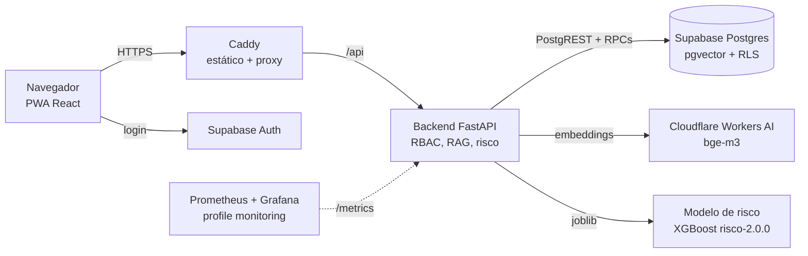

# ASA Turbo · v0.9

Agentes de IA para o ASA (Área do Sucesso Alvarista) da FECAP, com foco em reduzir a evasão.

- **ASA Turbo (estudante):** responde dúvidas com base nos documentos oficiais, sempre com fonte e data. Quando não tem segurança, não inventa: encaminha para um atendente.
- **Monitoramento de risco (atendente):** fila priorizada com score, fatores, tendência e recomendação. Toda ação passa por validação humana com justificativa. O estudante nunca vê o score.
- **Administração:** painel agregado e gestão da base de conhecimento (cadastrar, versionar, desativar).

Projeto Interdisciplinar · 5º CCOMP · 2026.2. Contexto e regras em [`CLAUDE.md`](CLAUDE.md).

## Rodar local (3 comandos)

Requisitos: Docker com o plugin compose e Python 3 (só para gerar o `.env`).

```bash
python3 infra/local/preparar_env.py   # gera .env com segredos aleatórios desta máquina
docker compose up -d --build          # ~3 min na primeira vez
xdg-open http://localhost:8080        # ou abra no navegador
```

A stack local não precisa de nenhuma chave externa. Ela inclui o Postgres, o login (GoTrue) e o PostgREST, no mesmo formato do Supabase, e carrega a base oficial, os dados fictícios e os usuários de demonstração. Sem chave da Cloudflare, o chat usa a busca lexical local; com a chave no `.env`, usa os embeddings bge-m3.

Para parar, use `docker compose down`. Para apagar também o banco local, `docker compose down -v`.

## Perfis de demonstração

| Perfil | E-mail | O que ver |
|---|---|---|
| Estudante | `estudante.demo@example.com` | Chat com fontes e data, feedback, abstenção com encaminhamento, histórico |
| Atendente | `atendente.demo@example.com` | Fila de risco filtrável, detalhe do caso, validação com justificativa, histórico |
| Administração | `admin.demo@example.com` | Painel agregado e base de conhecimento |

Senha dos três: `AsaTurbo#Demo2026`. Todos os dados de estudantes são **fictícios** (`seeds/`).

## Arquitetura



| Pasta | Conteúdo |
|---|---|
| `backend/` | API FastAPI (Python 3.12). Contrato em `docs/api-contract.yaml`. |
| `web/` | App React + Vite (PWA). Design system em `web/src/styles/`. |
| `ml/` | Modelo de risco v2 (`ml/artifacts/risco_v2.joblib`), avaliação do RAG, embeddings. |
| `infra/` | Dockerfiles, Caddy, migrations (`sql/`), stack local, deploy, monitoramento, backup, carga. |
| `seeds/` | Dados fictícios e usuários de demonstração. |
| `e2e/` | Testes ponta a ponta (Playwright). |
| `docs/` | Contrato da API, decisões, evidências, pendências. |
| `data/` | Dados reais do ASA. **Fora do Git, só local.** |

## Comandos úteis

| O quê | Comando |
|---|---|
| Testes do backend | ver `backend/README.md` (pytest, 170+ testes, sem rede) |
| Testes do modelo | `python -m pytest ml/tests` (ver `ml/README.md`) |
| E2E | ver `e2e/README.md` |
| Monitoramento | `docker compose --profile monitoring up -d` e Grafana em http://127.0.0.1:3000 |
| Backup / restauração | `infra/scripts/backup.sh` e `infra/scripts/restore.sh` |
| Teste de carga | ver `infra/loadtest/README.md` |
| Deploy em VM | ver `infra/deploy/README.md` |

## Documentos

- Contrato da API: [`docs/api-contract.yaml`](docs/api-contract.yaml)
- Mudanças: [`CHANGELOG.md`](CHANGELOG.md)
- Pendências conhecidas: [`docs/PENDENCIAS.md`](docs/PENDENCIAS.md)
- Decisões: [`docs/decisoes/`](docs/decisoes/)
- Evidências (testes, carga, a11y, Linux): [`docs/evidencias/`](docs/evidencias/)
